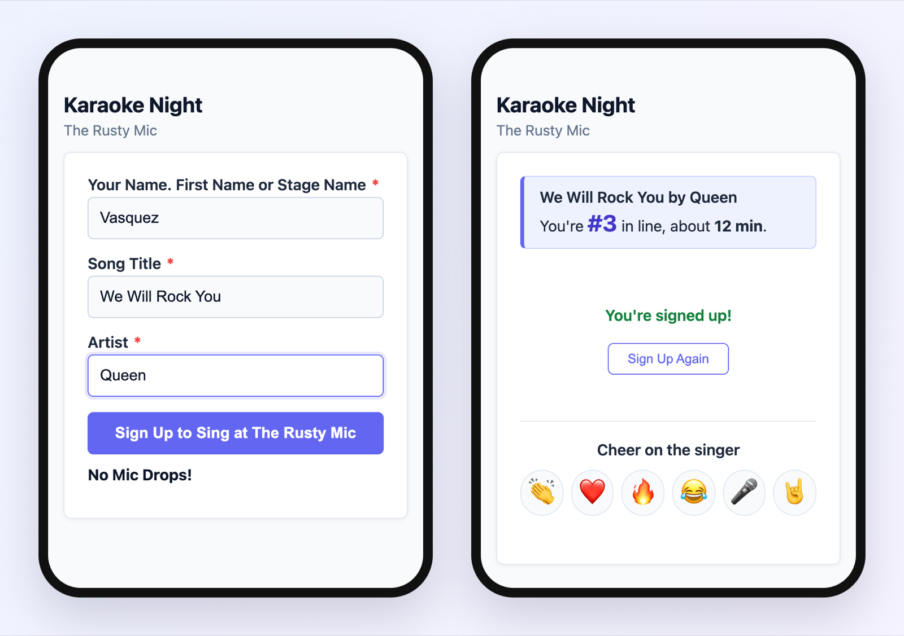
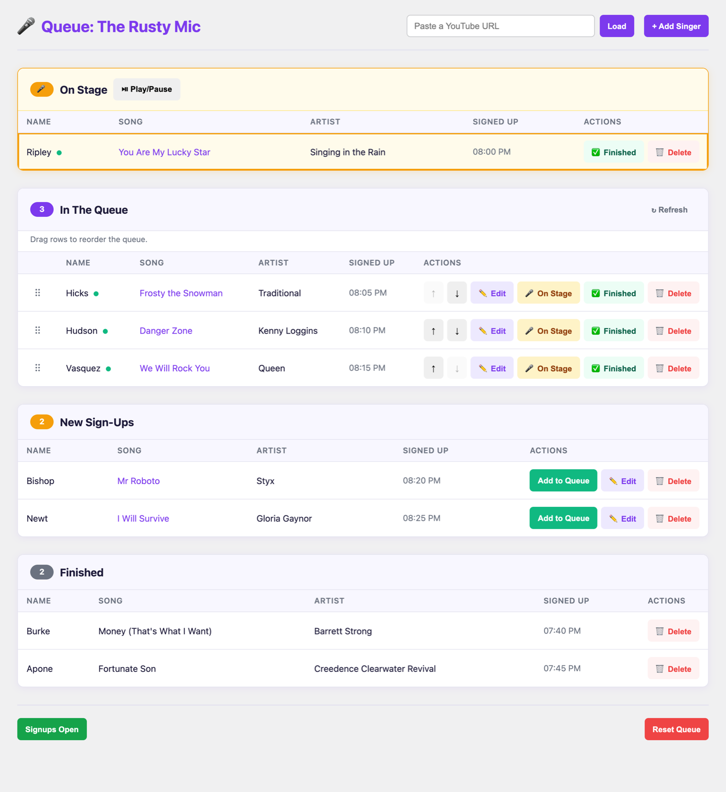
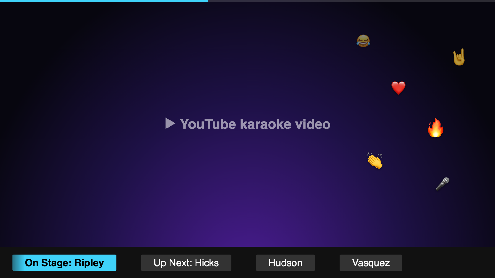
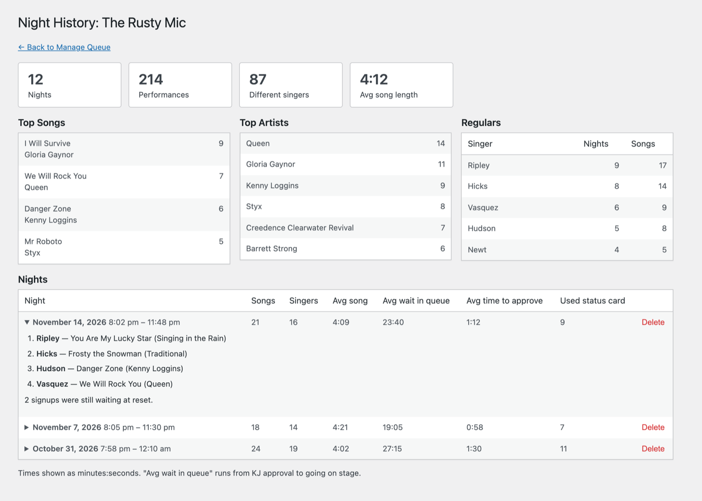

# WP Karaoke — Overview

WP Karaoke runs a karaoke night from WordPress. Singers sign up from their phones, the KJ (karaoke jockey) approves and orders them in the admin, and a TV in the room shows who's on stage and who's up next. The audience can cheer the singer with emoji that float up the TV screen.

The plugin has three parts that share one queue per venue:

| Part | Who uses it | Where it lives |
|---|---|---|
| **Singer Signup** block | Singers, on their phones | Any public page |
| **Queue Manager** | The KJ | WordPress admin → Karaoke → Manage Queue |
| **Now Playing** block | The room, on a TV or projector | A password-protected page |

> Screenshots use the plugin's built-in fake singers (the same ones the **Load Fake Singers** button adds) and a made-up venue ("The Rusty Mic").

---

## 1. Singers sign up from their phone

The **Singer Signup** block (`wp-karaoke/singer-signup`) is a three-field form: name, song title and artist. It submits without reloading the page.

- **Remembers the singer's name.** The name is saved in a cookie, so the next signup starts on the Song field.
- **Status card with a wait estimate.** After signing up, the singer sees a card for each song they've signed up for. It goes from "Waiting for the KJ to add you to the queue" to "You're #3 in line, about 12 min" to "You're up next! Head toward the stage." The card uses a private status token, refreshes every 20 seconds while the tab is visible, and comes back after a page reload. It can be turned off in the block settings.
- **Cheer on the singer.** Six reaction buttons (👏 ❤️ 🔥 😂 🎤 🤘) send emoji to the TV. Reactions only work while someone is on stage, and they're rate limited per visitor, per IP and per venue.
- **Signups can be closed.** When the KJ closes signups, the form is disabled and shows "Signups are currently closed."

## 2. The KJ runs the queue

The **Queue Manager** opens from the **Manage Queue** link on the Karaoke venue list. It's split into four sections:

- **On Stage:** the singer performing now, with a Play/Pause button for the TV's video.
- **In The Queue:** approved singers. Reorder them by dragging (touch-friendly, using SortableJS) or with the ↑/↓ buttons, then send one up with **On Stage**.
- **New Sign-Ups:** signups from the public form, refreshed automatically. One click on **Add to Queue** approves a singer.
- **Finished:** everyone who has sung tonight.

Other tools on this page:

- **YouTube search.** Click a song title to search YouTube for a karaoke video and attach it to the singer. A green dot next to the name means the attached video is playable. This needs a YouTube Data API key: `wp option update wpkq_youtube_api_key YOUR_KEY`.
- **Load a video now.** Paste a YouTube URL into the header bar to play it on the TV.
- **Signups Open / Closed** toggle and **Reset Queue**, which ends the night and saves it to Night History.

## 3. The room sees who's up

The **Now Playing** block (`wp-karaoke/now-playing`) runs full screen on a laptop connected to the TV.

- **Password gate.** The page asks for the monitor password set in the block. A correct password stores a cookie for that venue for 6 hours.
- **YouTube player** with a progress bar across the top, and a welcome message ("Welcome to {venue} Karaoke Night!") until the first video loads.
- **Ticker** along the bottom: the on-stage singer highlighted in cyan, then "Up Next" and the rest of the queue, with "+N More" past the block's limit.
- **Click to advance.** Clicking a queued singer in the ticker finishes the current singer, puts the clicked singer on stage and loads their video.
- **Audience reactions** from phones float up the right side of the screen.
- **Colors** for the ticker, on-stage badge and progress bar can be changed in the block settings.

## 4. Every night is saved

Each **Reset Queue** saves a permanent summary of the night: who sang what, in order. The **History** link on the venue list opens a page with:

- Totals: nights, performances, different singers and average song length.
- Top songs, top artists, and **regulars** (singers who came on more than one night).
- A table of nights with an expandable song list, average song length, average wait in the queue, average time for the KJ to approve a signup, and how many singers used the status card. Test nights can be deleted.

---

## How a night works

1. Create a **Karaoke venue** (WordPress admin → Karaoke → Add New).
2. Add the **Singer Signup** block to a public page and pick the venue. Share the link or a QR code in the bar.
3. Add the **Now Playing** block to another page, pick the venue and set a monitor password. Open it on the TV laptop.
4. Run the night from **Manage Queue**: approve signups, attach videos, send singers on stage.
5. Click **Reset Queue** at the end of the night to save it to Night History.

## Under the hood

- **Data:** each venue is a `karaoke-venue` post, and its queue is a JSON array in one post meta field. Night summaries are hidden `karaoke-night` child posts.
- **Singer statuses:** `kj-received` → `in-the-queue` → `on-stage` → `finished`.
- **REST API:** namespace `wpkq/v1`. Admin changes need `manage_options`. Public routes cover signup, status checks and reactions. The monitor authenticates with its venue cookie. See the endpoint table in [CLAUDE.md](CLAUDE.md).
- **Front end:** plain JavaScript (no jQuery), compiled with webpack from `assets/` and the block folders into `dist/`.

See [README.md](README.md) for installation and build steps, and [CONTEXT.md](CONTEXT.md) for the full behavior spec.
